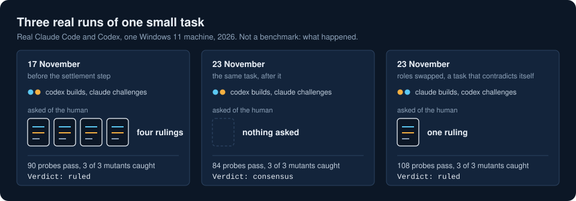
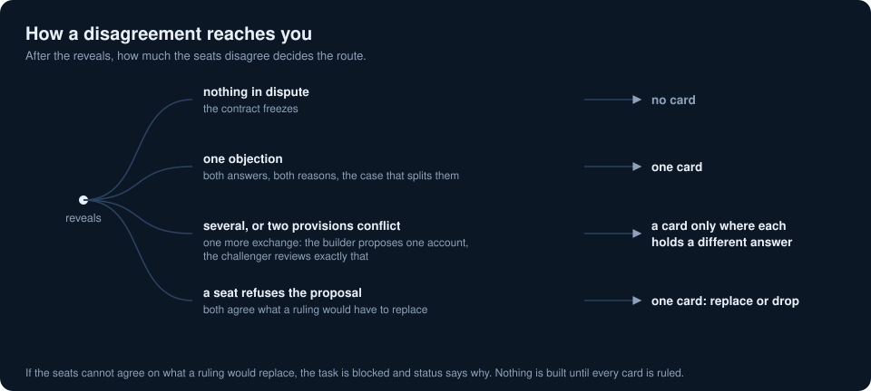
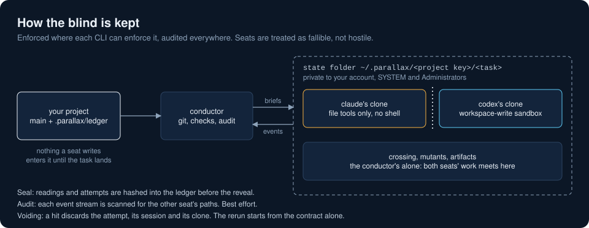

<p align="center">
  
</p>

Parallax pairs Claude Code and Codex on every change. One builds it. The other, without seeing the code, writes the checks that will judge it. When they agree, the change lands on `main` with a receipt saying who built it, who challenged it and what was checked. When they disagree, you get one card with both answers and the concrete case that tells them apart.

The conductor that runs this is plain Python with no model inside. It drives `claude -p` and `codex exec`, does all the git work, runs every check, and spends no tokens of its own.

Jump to [see it run](#see-it-run), [what real models did](#what-real-models-did), [use it on a project](#use-it-on-a-project), or the [documentation](docs/README.md).

## The idea

A model that reviews its own work shares its own blind spots. Two different models make less correlated mistakes than two copies of one. So Parallax does not split a project between two agents. It splits every task into two sides:

- The **builder** writes the change, plus a few deliberately broken copies of it called mutants.
- The **challenger** writes the probes from a frozen contract alone. It never sees the builder's files.

Then the two meet for the first time, at the **crossing**: the probes must pass on the change and fail on every mutant. A green run counts only because the checks were written blind and shown able to fail.

Agreement is evidence. Disagreement is the valuable output: it is either a bug or a hole in the spec, and it is the only thing that reaches you.

<p align="center">
  
</p>

Roles swap every task, so each model spends half its time being checked by the other. More in [The life of a task](docs/life-of-a-task.md).

## See it run

The stub demo needs neither CLI and spends nothing. Scripted seats disagree about one deliberately underspecified task: `clamp(x, lo, hi)`, which says nothing about `lo > hi`.

```powershell
python -m pip install -e .
```

```powershell
python -m parallax demo --stub
```

<p align="center">
  
</p>

The run stops with a card and exit code 2. Rule on it with the command the run prints, run the demo again on the same folder, and the change lands with its receipt. The replay above is condensed from the demo's real output: the folder arguments are cut and the card is folded to fit.

Drop `--stub` and the same demo runs on the real CLIs, spending tokens on both subscriptions.

## What real models did

Three runs of the demo task with real seats, on one Windows 11 machine. Nothing here is a benchmark; it is what happened, with dates.

<p align="center">
  
</p>

| Run | Builder / challenger | What the models did | Asked of the human | Result |
|---|---|---|---|---|
| 2026-11-17 | Codex / Claude | Agreed that `lo > hi` raises, split on four other reading questions | Four rulings | Landed, `ruled`: 90 probes, 3 of 3 mutants caught |
| 2026-11-23 | Codex / Claude | Codex objected to five of Claude's nine decisions; the seats flagged ten conflicts, then settled them in one exchange | Nothing | Landed in about ten minutes, `consensus`: 84 probes, 3 of 3 mutants caught |
| 2026-11-23 | Claude / Codex | Task written to contradict itself. The challenger refused the builder's proposal over one dropped guarantee | One card | Landed after one failed crossing and a repair, `ruled`: 108 probes, 3 of 3 mutants caught |

The first run asked four questions that were largely one question. That finding produced the settlement step: when the seats disagree in several places, they get one more exchange before you do, and only a choice where each still holds a different answer becomes a card. The second run is the same task after that change.

The full account, including token use and what has only run on stub seats, is in [Field notes](docs/field-notes.md).

## Every commit carries its receipt

<p align="center">
  
</p>

The receipt is the trailers of the landing commit, so `git log` is the audit trail. Main never receives a failing check. The decisions behind each receipt (readings, contract, attempts, crossings, rulings) travel with the code in `.parallax/ledger.jsonl`. More in [Receipts and the ledger](docs/receipts.md).

## How a disagreement reaches you

<p align="center">
  
</p>

A card shows both answers, each seat's reason, and a witness: a concrete call on which the answers differ. Opinions do not open disputes; evidence does. The conductor never waits at a prompt. It writes the card, prints it and exits, and `parallax rule` records your answer. A ruling scoped to the project becomes a precedent, so a settled question is not asked again while its conditions hold. More in [Rulings and precedents](docs/rulings.md).

## Use it on a project

From the project's folder:

1. `python -m parallax init` writes `parallax.toml` and `.parallax/`. Set the `check` and `lint` commands, the paths each role may write, and the two seats. Commit them.
2. Write the task as a short spec in `tasks/<id>.md`.
3. `python -m parallax run tasks/<id>.md` runs or resumes the task until it lands, needs a ruling, or is blocked.
4. When it prints a card, answer with `python -m parallax rule <dispute> a|b|other|drop`, then run the same task again.
5. `python -m parallax status` lists tasks and what each waits on.

A run can be interrupted at any step. Every step records its completion, and the next `run` works out where it stopped.

Reference: [commands](docs/cli.md) and [parallax.toml](docs/configuration.md).

### Requirements

- Windows 11. It is the target, and nothing here is tested elsewhere.
- Python 3.12. Standard library only: there are no dependencies to install.
- git, with a user name and email set.
- Claude Code and Codex CLIs, both signed in, for real runs. The stub demo and the test suite need neither.

## How the blind is kept

<p align="center">
  
</p>

Each seat works in its own clone, under a random name, in a state folder outside your repo that is private to your account. Codex runs in its sandbox; Claude gets file tools restricted to its folder and no shell. Readings and attempts are hashed before anything is revealed. After every call the conductor scans the seat's event stream for the other seat's paths, and a hit voids the attempt along with its session and clone. More in [Keeping the blind](docs/blind.md).

## What it does not claim

- The audit is best effort. Seats are treated as fallible, not hostile: a script that read the other clone without naming it would get past the scan.
- A receipt says every landed change matched its accepted inventory of files. It does not say an independent reviewer judged each file relevant.
- It runs one task at a time, with two seats, on Windows.
- An A/B card, the direct settlement path and a run killed mid-step have so far run only on stub seats, not with real models.
- The committed ledger of a task landed before 2026-11-23 records each seat clone's full path, home folder included. Newer records hold only the clone's folder name. Check an older project's `.parallax/ledger.jsonl` before publishing it.

## How it was built

Parallax was designed the way it works. Claude Code and Codex each wrote a proposal without seeing the other's, then each reviewed the other's. They arrived at the same core independently, which is the main reason to trust it. The [design document](docs/superpowers/specs/2026-11-16-parallax-design.md) records which decisions were the human's rulings and which were the agents' proposals, and keeps a dated list of what has been verified on a real machine and what has not.

- About 6,200 lines of Python, standard library only.
- 407 tests run the conductor's every branch on scripted stub seats, spending nothing: disagreement, each settlement path, ruling, failed crossing, surviving mutant, repair, voided attempt, and resuming after an interruption at each step.
- `scripts/probes/seat_smoke.py` reproduces what the real CLIs were observed to do and exits non-zero if any expectation fails. It is rerun whenever either CLI updates.

```powershell
python -m unittest discover -s tests -t . -v
```

More in [Architecture](docs/architecture.md).

## Documentation

| | |
|---|---|
| [Concepts](docs/concepts.md) | Why two models, and the dozen terms everything else uses |
| [The life of a task](docs/life-of-a-task.md) | The nine steps from a spec file to a commit on main |
| [Rulings and precedents](docs/rulings.md) | Cards, how to answer them, and how answers persist |
| [Receipts and the ledger](docs/receipts.md) | What a receipt says and what the ledger keeps |
| [Keeping the blind](docs/blind.md) | Placement, confinement, seal, audit and voiding |
| [Commands](docs/cli.md) | Every command, flag and exit code |
| [parallax.toml](docs/configuration.md) | Every key, with a full example |
| [Architecture](docs/architecture.md) | Module map, state on disk, seat adapters, tests |
| [Field notes](docs/field-notes.md) | The real runs, what they cost and what they changed |
| [FAQ](docs/faq.md) | Short answers to the first questions |
| [Design document](docs/superpowers/specs/2026-11-16-parallax-design.md) | The original design, its rulings, and what is verified |

## Status

v0: one task end to end, with real seats, from one command. Next on the list: two or more tasks in flight with crossed roles, experiments as a dispute step, assumptions as first-class claims that can be flipped and rerun, a scoreboard of which seat should build what, a live view, and more seats.

## License

MIT. See [LICENSE](LICENSE).
