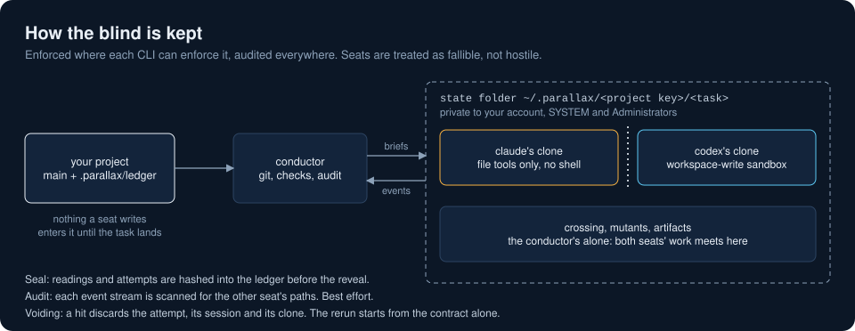

# Keeping the blind

The challenger writes its probes without seeing the builder's code, and the builder works without seeing the probes. This page says how Parallax arranges that: where each seat works, what confines it, how its work is sealed, how the conductor audits what it did, and what happens when the audit finds a breach. It also covers who may write which files, and it states the limits of all of this plainly.

<p align="center"></p>

## What is arranged, and what is audited

The operating system cannot keep one agent from reading the other's work. Codex's sandbox limits where an agent writes, not what it reads. So the blind has to be arranged and audited:

- **Enforced** where each CLI can enforce it.
- **Audited** everywhere, after the fact.

Seats are treated as fallible, not hostile, and no receipt claims more than that.

What is blind is the work: the builder's code and mutants, and the challenger's probes, until the crossing. The readings are not blind. They are shown to the other seat on purpose, at the reveal, so each seat can say where it agrees. Each clone starts as a copy of the project at the task's base commit, so a seat can read the existing project. What it must not see is the other seat's work.

## Placement

Each seat works in its own clone of the project. The two clones have no git link to each other. Each is a separate clone, not a linked worktree, because a linked worktree would let one seat find the other through git, and the seat's commits would sit in the project's repository where the other seat could read them.

The clones sit in a state folder in your home folder, outside the repo:

```text
~/.parallax/<project key>/<task>/<seat>-<random>
```

- The state folder is `~/.parallax` unless the `PARALLAX_HOME` environment variable names another.
- The project key is a short hash of the project's path.
- A seat is told only its own path. It runs in its clone, and every brief has absolute paths replaced with `<outside>/<file name>` before the seat sees it.
- Nothing a seat produces enters the project's repo until the task lands.
- The state folder must not be under `%LOCALAPPDATA%` or `%APPDATA%`. A process started from a packaged app (Claude's desktop app is one) has new folders there silently redirected, and Codex's sandbox then cannot find them.

Besides the two clones, the task's folder holds the conductor's own working areas: the throwaway clone where the crossing runs, the folder where mutants are kept once the builder hands them in, the clone used for landing, and the stored output of every seat call. The seats never need these.

## Confinement

Each task's folder in the state folder is made private before anything is put in it. Its permissions name only your account, SYSTEM and Administrators, and everything inside inherits that. Before every seat call, the conductor checks that the folder is still private. If it is not, the task is blocked.

**Codex** runs in its `workspace-write` sandbox. For calls that do not write (readings, reveals, settlement proposals and reviews) it runs read-only. On this machine the sandbox runs commands as a separate Windows user. Codex adds entries for that user to the one clone it works in and to nothing else, so the other seat's clone, the scratch clones and the artifacts stay closed to it. A sandboxed read of a private sibling folder was refused with "Access is denied", both in `%TEMP%` and under the home folder.

**Claude** gets file tools restricted to its own clone and no shell at all: `Read`, `Write`, `Edit`, `Glob` and `Grep`, and only `Read`, `Glob` and `Grep` for calls that do not write. Under `--restricted`, a read outside its folder is refused and reported in the event stream.

Both seats launch without your personal plugins, hooks and MCP servers (`--safe-mode` for Claude, `--ignore-user-config` for Codex), so the brief is the only instruction they get and nothing else spends tokens. Both are launched with other agents' environment variables removed. Codex needs its `[windows] sandbox` setting passed in again, or every command is refused.

Codex appends a trust entry for each new folder it runs in to `~/.codex/config.toml`, even with `--ignore-user-config`. When a task ends, the Codex seat removes the entries it added for that task's folders. This is the one place Parallax edits a file outside its own folders.

## Seal

Readings and attempts are hashed into the record before they are revealed, so nothing can be adjusted afterwards. The record is the journal, which joins the ledger when the task lands.

- A reading is stored as canonical JSON in the task's folder, and its SHA-256 is recorded in `reading.sealed` before either reading is shown to anyone. When the reveal and the settlement read a reading back, they use the stored output that matches the recorded hash.
- A finished attempt is recorded as the commit it produced, together with its file inventory, before the crossing. The crossing uses exactly those commits.

## Audit

Both CLIs emit an event stream that lists what a seat did. After a seat call, the conductor scans that stream for any path that belongs to the other seat or to the conductor's own folders in the task's folder: the crossing clone, the landing clone, the stored mutants and the artifacts. The comparison is case-insensitive and treats forward and backward slashes alike.

This is the second line of defense, and it is best effort. It matches paths written in the stream. A script that reads another worktree without naming it would get past.

## Voiding

A hit voids the attempt, and the contamination goes with it: the seat's session, its clone and everything the attempt produced are discarded. The rerun is a new session in a new clone, starting from the contract alone.

- A voided reading is rerun from the task alone. A voided repair after a crossing restarts in a new clone at the seat's last accepted commit, with a new session.
- The void is recorded as `reading.voided` or `attempt.voided`, with the paths that were hit.
- If the same step is voided twice, the task is blocked, and the run says which seat and which paths.
- Voiding applies to readings, builds, probes and repairs. A hit in a reveal, a settlement proposal or review, or a chore blocks the task instead.

## Seats never message each other

Everything a seat learns about the other side arrives from the conductor:

- the other seat's reading, at the reveal (step 3);
- on the confirmed batch route, the builder's proposal, in the challenger's review brief (step 4);
- the crossing evidence after a failed crossing (step 8): check output, and for a surviving mutant a description and a diff. Seats get this as evidence, not as files.

Free messaging between seats is an anti-goal. Seats would anchor on each other, and the independence the design relies on would be gone.

A seat keeps one session for the length of a task, so a repair starts with its own context. The exceptions are a voided attempt, as above, and a new task, which always starts a new session.

## Who may write what

The blind only means something if each seat stays inside its own half.

- **Paths.** Each role has path patterns in `[scopes]` in `parallax.toml`: for example, builder `src/**` and challenger `tests/**`. `*` matches within one path segment and `**` matches any depth. Matching is case-sensitive, relative to the project root.
- **Exclusive paths.** Files both roles would need, such as lockfiles and manifests, are listed as `exclusive` and belong to the builder for that task.
- **Working folders.** Inside a clone, `.parallax-mutants/<id>/` holds the builder's mutants and `.parallax-scratch/` holds scratch notes. The conductor moves mutants out and neither folder ever lands. `.parallax/` belongs to the conductor.
- **Seats only edit files. The conductor does all the git work.** It checks every changed path against the seat's patterns, rejects the attempt if any falls outside, and makes the commits itself. A seat does not run git.
- **The conductor runs every check.** Seats are not relied on to run project tools. Their briefs say they cannot run the project's tests, and on this machine Codex's sandbox cannot execute Python at all. A project may name a quick `lint` command. The conductor runs it on a seat's clone after each attempt, and a failure goes straight back to that seat without using up a repair round.
- **Inventories.** Every seat call that writes returns the full list of files it has changed since the task began, with each file's change and purpose. The conductor rejects work whose actual changes differ from the list. Before landing, it checks that only declared files and its own records are staged, and that no commit hook changed the commit.

Every landed seat change matched its accepted inventory; relevance is not independently reviewed.

A seat edits and runs commands inside its own clone without asking. That was a ruling of the human's, and the confinement above is how it is bounded.

## Limits

- **The audit is best effort.** It scans an event stream for paths. It cannot see a read that does not name the path.
- **Seats are fallible, not hostile.** Isolation beyond what the two CLIs provide, such as separate operating-system users or containers of Parallax's own, is deferred.
- **Confinement depends on each CLI's behavior.** What a Windows sandbox user can read is decided by folder permissions, and `--restricted` is Claude's own feature. Both were observed on one machine, on the dates the [design document](superpowers/specs/2026-11-16-parallax-design.md) records (2026-11-16 and 2026-11-17). `scripts/probes/seat_smoke.py` reproduces those observations and exits non-zero if any fails. Rerun it, and `scripts/probes/job_object_seats.py`, when either CLI updates.
- **The target is Windows 11.** Nothing here is tested elsewhere.
- **A receipt says no more than this.** See [Receipts and the ledger](receipts.md).

## See also

- [Documentation index](README.md)
- [Concepts](concepts.md)
- [The life of a task](life-of-a-task.md)
- [Rulings and precedents](rulings.md)
- [Receipts and the ledger](receipts.md)
- [Commands](cli.md)
- [parallax.toml](configuration.md)
- [Architecture](architecture.md)
- [Field notes](field-notes.md)
- [FAQ](faq.md)
