# The life of a task

A task goes from a spec file to a commit on `main` in nine steps. This page follows one task through them, says what the conductor and each seat do at every step and what gets written down, and then covers chores, repair rounds and resuming after a pause or a crash.

<p align="center"></p>

The terms (seat, reading, contract, probe, mutant, crossing) are defined in [Concepts](concepts.md). The conductor is ordinary Python with no model in it. It starts the seats, does all the git work and runs every check.

## The task file

A task is a short spec in `tasks/<id>.md`. The id is the file name without `.md`: letters, digits, `.`, `_` and `-`, starting with a letter or digit.

A task is a behavior change unless its first non-blank line is `Kind: chore` (see [Chores](#chores)). The task's title is its first line after that marker, with any leading `#` removed. It becomes the subject of the landing commit, cut to 60 characters at a word boundary.

```powershell
python -m parallax run tasks/clamp-001.md
```

## One run, in order

This is the stub demo's task, `clamp(x, lo, hi)`, which says nothing about `lo > hi`. The first `run` prints these progress lines and stops with a ruling card:

```text
clamp-001: opened (behavior); builder codex, challenger claude
clamp-001: claude's reading sealed
clamp-001: codex's reading sealed
clamp-001: claude's reveal done
clamp-001: codex's reveal done
clamp-001: settlement published (direct)
clamp-001: needs a ruling on D-clamp-001-1
```

After `parallax rule D-clamp-001-1 a`, running the same task again continues from where it stopped:

```text
clamp-001: contract v1 frozen
clamp-001: codex's build 1 finished
clamp-001: claude's probe 1 finished
clamp-001: crossing 1: check passed, 3 of 3 mutants caught
clamp-001: landed 1a0a4035f05a
```

The real landing line continues with each seat's token totals. The ledger events of that run, in order, were:

```text
task.opened
checkout.created      (twice: one clone per seat)
reading.sealed        (twice)
reveal.done           (twice)
reading.settled
ruling.made
contract.frozen
attempt.started       (twice)
attempt.finished      (twice)
crossing.done
task.integrated
```

| Step | What happens | Ledger events |
|---|---|---|
| 1. Open | Roles assigned, one clone per seat | `task.opened`, `checkout.created` |
| 2. Sealed readings | Each seat reads the task alone | `reading.sealed` |
| 3. Reveal | Each seat reviews the other's reading | `reveal.done` |
| 4. Settlement and rulings | The conductor settles, the human rules on any card | `reading.settled`, `ruling.made` |
| 5. Contract | The settled points are frozen and hashed | `contract.frozen` |
| 6. Braid | Build and probes are written in separate clones | `attempt.started`, `attempt.finished` |
| 7. Crossing | The two meet in a throwaway clone | `crossing.done` |
| 8. Verdict | Clean, or each failure becomes evidence | none when clean |
| 9. Integrate | Main moves, with the receipt | `task.integrated` |

The ledger is written in two stages, described in [Receipts and the ledger](receipts.md). While a task runs its events go to a journal. The task's events join the ledger in the landing commit.

## 1. Open

The conductor reads the task file and assigns the roles. Unless `--builder SEAT` names one, roles alternate: the builder is the seat at position `k modulo 2` in the `[seats]` order of `parallax.toml`, where `k` is the number of other tasks already opened in the project. The other seat is the challenger.

The conductor records `task.opened` with the task's kind, title, the commit `main` was at (the base every later diff is measured from), and both seats. A recorded opening is never changed. It then makes the task's state folder private and puts one fresh clone of the project in it for each seat, recorded as `checkout.created`. Where those folders live and why is in [Keeping the blind](blind.md).

## 2. Sealed readings

Both seats are called at the same time. Each is told its role and the write paths of both roles, and is given the task text and the precedents in force. It sees nothing from the other seat. The call is read-only. Each seat returns a reading:

- **The interface** it expects: files, names, signatures, and the forms results and errors can take.
- **Decisions**: each behavior guarantee or independent open choice, as a question, a proposed answer and a reason. The conditions that select an outcome belong here, not in the interface.
- **Predicted failures**: where it expects an implementation to go wrong.

The conductor stores each reading and records its sha256 in `reading.sealed`, together with the seat's session id and token usage, before either reading is shown to anyone. A seat keeps this session for the length of the task.

## 3. Reveal

Each seat now sees the other's reading, in the same session, and gives a verdict on every decision in it. Agreement needs no explanation. A disagreement must carry:

- a counteranswer, written so it could go straight into a contract;
- a witness: a concrete scenario, what to observe, what the other answer predicts there, and what the counteranswer predicts.

The conductor rejects a witness that predicts the same result under both answers, and the seat is asked again. A seat may say the original answer makes no commitment on that case (`no commitment`). The challenger also accepts the builder's interface or gives a reason and a complete replacement. Either seat may name two provisions that cannot both stand, with a reason.

Opinions do not open disputes. Evidence does.

## 4. Settlement and rulings

The conductor settles from the reveals. How much the seats disagree decides the route: no card, one card, one more exchange between the seats, or a card that asks for a replacement. [Rulings and precedents](rulings.md) covers the four routes, the card, and `parallax rule`.

On a task opened by the current version, three things are true on every route:

- The settlement is published once, as one `reading.settled` record that holds every card's text. Card files are written from it.
- If any card is open, the run prints the cards and stops with exit code 2. The conductor never waits at a prompt.
- Nothing is built until every card has a ruling.

## 5. Contract

The conductor writes the contract from the settled points: the task text, the interface, each decision with where its answer came from (agreed, signed by both seats, or ruled, with the card's id), and the precedents in force. It hashes the text and records the hash in `contract.frozen` as `sha256:...`. The hash of the latest version is the `Parallax-Contract` trailer on the receipt.

The contract is a file in `.parallax/run/<task>/`, versioned `contract-v1.md`. Rulings made after a failed crossing can add points, which freeze as v2 and later. At landing the latest contract is committed as `.parallax/contracts/<task>.md`.

## 6. Braid

The two seats now work at the same time, each in its own clone, each from the contract alone. Neither sees the other's files.

- **The builder** writes the change, then a small number of mutants. A mutant is a full copy of each file it changes, placed in `.parallax-mutants/<id>/` inside the builder's clone. It makes one small behavior change the contract forbids. The number is `mutants` in `[policy]`, 3 by default.
- **The challenger** writes probes: automated tests, written from the contract, that follow the project's own test layout so the `check` command finds them.

Seats only edit files. Neither runs git or the project's tests. When a seat returns, the conductor checks its work before accepting it:

- every changed path is inside the seat's write paths;
- the mutants exist, differ from the real code, and sit inside the builder's paths;
- the `files` inventory the seat returned matches what actually changed;
- the project's `lint` command, if there is one, passes.

A failure goes straight back to the same seat, in the same session, as a rejection with the reason. A lint failure is such a rejection. It does not use up a repair round. Two rejections of one attempt block the task. When the work is accepted, the conductor moves the mutants out of the clone, commits the work itself and records `attempt.finished` with the commit, the mutants, the inventory and the token usage.

## 7. Crossing

The builder's change and the challenger's probes meet for the first time. The conductor does this in a third, throwaway clone, `cross`, in the task's state folder:

1. Check out the builder's commit and apply the challenger's changes on top.
2. Run the project's `check` command. The output is saved as `.parallax/run/<task>/crossings/<n>/check.txt`, and the number of probes is read from it with `count_pattern`.
3. If it passed, run the same command once per mutant with that mutant's files swapped in. A mutant is caught when the check fails with it, and survives when the check passes.

The result is recorded as `crossing.done`.

## 8. Verdict

A crossing is clean when the check passed and every mutant was caught. A mutant the human has waived also counts as handled (see [Rulings and precedents](rulings.md)). A clean crossing goes to step 9.

Anything else is evidence: a failed check, or a mutant the probes did not catch. Each piece of evidence gets a dispute id, and the seats answer it. See [When the crossing fails](#when-the-crossing-fails).

## 9. Integrate

Landing is automatic once the gates pass. The human is not asked to approve merges. The conductor:

1. Clones current `main` into a `land` folder and applies each seat's accepted commits.
2. Adds its own records: the task's ledger events, the contract, and a regenerated `.parallax/PRECEDENTS.md`.
3. Checks that every staged change is either a path some seat declared in its inventory or one of those records.
4. Re-runs the `check` command on that tree. A failure here blocks the task. Main is not touched.
5. Commits with the receipt as trailers, and verifies the commit's tree is exactly the staged tree, so a commit hook cannot have changed it.
6. Moves `main` only if it is still where step 1 found it. If it moved, the conductor starts again from the new `main`, up to three times.

If `main` is checked out and uncommitted edits stand in the way of a fast-forward, `main` is left alone and the result is parked on the branch `parallax/ready/<task>`. The run ends with exit code 3. The human's edits are untouched.

After `main` moves, the conductor forgets the task's journal entries, discards the seats' sessions and removes the task's state folder. The receipt is explained in [Receipts and the ledger](receipts.md).

## Chores

A task whose first non-blank line is `Kind: chore` does not change behavior (docs, renames). One seat builds it, and no one challenges it.

- **Open:** roles are assigned as usual, but only the builder gets a clone.
- **No readings, reveal, settlement, contract, braid or mutants.** The builder makes one call, with the task text. It may change any file the task needs, except Parallax's own folders. The conductor still checks the `files` inventory and runs `lint`.
- **Check:** the conductor runs the project's `check` once on the builder's work. If it fails, the task is blocked. There is no dispute and no repair round.
- **Receipt:** the verdict is `solo`, meaning not pair-verified. It has no `Parallax-Contract` and no `Challenged-by` trailer, because there was neither a contract nor a challenger.

## When the crossing fails

If the crossing is not clean, the conductor reserves a dispute id for the failure: one for a failed check, or one for each surviving mutant that has not been waived. It then asks the seats to answer with the evidence in their brief. For a failed check both seats answer. For surviving mutants only the challenger does, because only its probes can change the outcome.

Each seat answers every dispute id with one of:

- **concede**: its own side is wrong, and it repairs that side now, in the same call;
- **contest**: its side follows the contract, and it quotes the contract line that says so. It changes nothing.

Then:

1. If any seat conceded and actually changed something, the conductor crosses again. A concession that changes nothing does not count.
2. If nobody conceded, the contract is ambiguous at that point and the question goes to the human as a card. After the ruling, the losing side repairs with the ruling in its brief, and the conductor crosses again.
3. At most two repair rounds are allowed (`max_repair_rounds` in `[policy]`). When the crossing that follows them is still not clean, the human gets the unresolved tradeoff as a card: the probes are wrong, the code is wrong, or drop the task.

The human's rulings, including accepting a limitation or waiving a mutant, are covered in [Rulings and precedents](rulings.md). Main never receives a failing check.

## Pauses, crashes and resuming

Every step records its completion as an event, and every step looks for its own completion event first and skips itself if it finds one. That is the whole resume mechanism. Running the same task again works out the current step from the records, whatever stopped it.

- **A pause for a ruling:** `run` exits with code 2. After `parallax rule`, run the same task again.
- **A crash or a closed terminal:** run it again. An attempt that started but never finished is discarded and rerun: the conductor resets that seat's clone to its last accepted commit and starts the call again.
- **A crash during landing:** if `main` had already advanced, the next `run` finds the task's landing commit by its `Parallax-Task` trailer and finishes the cleanup. It does not land twice.
- **A task that has already landed:** `run` reports that it landed and exits 0.
- **A blocked task:** the run stops with a reason and exit code 3, for example a seat that failed twice in a row, an attempt rejected twice, or a check that failed on top of `main`. Fix the cause and run the same task again.

Only one run may be active in a project. A lock file in `.parallax/run/` holds the process id, and a run that finds a live one reports `another parallax run is active`. A lock whose process is gone is cleared.

The events are written one line at a time, each with its newline in one flushed write, so a torn write at the end of the file is ignored rather than read as an event.

`parallax status` lists each task and what it waits on. On this machine the real CLIs have carried tasks through a pause for a ruling and a resume. A run killed in the middle of a step has been exercised only on scripted stub seats. [Field notes](field-notes.md) has the dated record.

## See also

- [Documentation index](README.md)
- [Concepts](concepts.md)
- [Rulings and precedents](rulings.md)
- [Receipts and the ledger](receipts.md)
- [Keeping the blind](blind.md)
- [Commands](cli.md)
- [parallax.toml](configuration.md)
- [Architecture](architecture.md)
- [Field notes](field-notes.md)
- [FAQ](faq.md)
