# Receipts and the ledger

Every commit Parallax lands on `main` carries a receipt: git trailers that say who built the change, who challenged it, what was checked and how any dispute ended. This page explains each trailer and each verdict, what a receipt does and does not claim, and where the decisions behind it are kept.

<p align="center"></p>

## The receipt

This is the receipt of the first real run with real CLIs that used the settlement step, on 2026-11-23, as it appears in the commit message:

```text
clamp-001: Add clamp(x, lo, hi) to clamplib: returns x limited to the

Parallax-Task: clamp-001
Parallax-Contract: sha256:c317c9e49ac1b13afe00d33f5d13ebe36d9b0dd8f60c42f6be27c096a93fe083
Built-by: codex gpt-6.2-astra/xhigh
Challenged-by: claude fable/high
Checks: 84 probes passed, 3 of 3 mutants caught
Verdict: consensus
```

The subject is the task id and the task's title, cut to 60 characters at a word boundary. That is why this one ends mid-sentence. The trailers are the last paragraph of the message, so git reads them as trailers.

| Trailer | Meaning |
|---|---|
| `Parallax-Task` | The task id, which is the task file's name without `.md`. |
| `Parallax-Contract` | `sha256:` and the hash of the latest frozen version of the contract, which both seats worked from. The contract text is committed with the change, so the hash can be checked. |
| `Built-by` | The seat that built the change, with the model and effort it was launched with. |
| `Challenged-by` | The seat that wrote the probes, in the same form. |
| `Checks` | What the last crossing showed: the number of probes that passed, and how many mutants were caught. |
| `Verdict` | How the task got here. One of five values, below. |
| `Limitation` | Present only when a limitation was accepted. One trailer for each. |

Model and effort are set explicitly on every launch, because Codex's event stream does not report them.

### The contract hash

The contract is committed at `.parallax/contracts/<task>.md` in the same commit. The hash is the SHA-256 of that text with line endings normalized to LF. It lets a reader confirm that the contract in the commit is the one the probes were written from.

### The checks line

```text
Checks: 84 probes passed, 3 of 3 mutants caught
```

- The number of probes is read from the output of the project's `check` command in the last crossing, using the `count_pattern` setting (by default, the number in a line like `Ran 84 tests`). It is the count the check command reports, so it includes tests that were already in the project. When the pattern finds no number, the line starts `check passed` instead.
- The mutant count has the form "caught of total". A mutant the human waived counts as not caught, so a waiver turns `3 of 3` into `2 of 3`. A project that asks for no mutants gets only the first half.

## The five verdicts

| Verdict | Meaning |
|---|---|
| `consensus` | Clean at the first crossing, with no human ruling. |
| `resolved` | The seats settled a dispute between themselves: an earlier crossing was not clean, and they repaired it without the human. |
| `ruled` | A human ruling was needed. |
| `limited` | Accepted with a stated limitation. |
| `solo` | Not pair-verified. A chore, built by one seat. |

The conductor decides the verdict in this order, and the first rule that fits wins: a chore is `solo`; a task with any limitation is `limited`; a task with any ruling is `ruled`; a task with any crossing that was not clean is `resolved`; anything else is `consensus`.

`consensus` describes the crossing and the rulings. Disagreement in the reveals that the seats settled between themselves, without a card, does not change it. In the 2026-11-23 run above, Codex objected to five of Claude's nine reading decisions, and the verdict was still `consensus`, because the settlement exchange needed no ruling and the first crossing was clean.

## What a chore's receipt omits

A chore has no contract and no challenger. Its receipt has no `Parallax-Contract` and no `Challenged-by` trailer, the `Checks` line is `check passed`, and the verdict is `solo`:

```text
Parallax-Task: <task>
Built-by: <seat> <model>/<effort>
Checks: check passed
Verdict: solo
```

## The limitation trailer

A limitation is written when the human accepts the change with a stated limitation, or waives a mutant (see [Rulings and precedents](rulings.md#limitations-and-waivers)). Each is one trailer:

```text
Limitation: mutant m2 waived: <the human's note>
```

A trailer is one line, so runs of whitespace in the text, line breaks included, are collapsed to single spaces. The verdict is `limited`.

## What a receipt claims

- **Main never receives a failing check.** Before main moves, the conductor re-runs the `check` command on the final tree, on top of the current `main`. A failure blocks the landing. Accepting a limitation does not change this: the contract and the probes are amended first, and the crossing runs again and passes.
- **Every landed seat change matched its accepted inventory; relevance is not independently reviewed.** Each seat call that writes returns the full list of files it changed, each with a purpose. The conductor rejects work whose actual changes differ from the list. Before landing it checks that only declared files and its own records are staged, and that no commit hook changed the commit. A seat that lists a file nobody needs still lands it.
- **The verdict says how the task got here,** by the rules above.

## What a receipt does not claim

- **That the blind was unbreakable.** The blind is enforced where each CLI can enforce it and audited everywhere else, and the audit is best effort. A receipt says no more than that. See [Keeping the blind](blind.md).
- **That relevance was reviewed.** The inventory check is about whether a change was declared, not whether it was needed.
- **That the mutants cover every plausible mistake.** The builder writes the mutants. `3 of 3 mutants caught` shows that the probes failed on those three mutants. It says nothing about mistakes nobody wrote down.
- **That a `solo` task was verified by a second model.** It was not.

## The ledger

`.parallax/ledger.jsonl` in the project is the source of truth for decisions. It is plain text, one JSON object per line, so that either agent, the human and git can all read it. Each event has a UTC timestamp `ts`, a `type` and a `task`, followed by the event's own fields.

| Event | Written when |
|---|---|
| `task.opened` | The task is opened: its kind, base commit, builder and challenger. |
| `checkout.created` | A seat's clone is made. |
| `reading.sealed` | A seat's reading is hashed. Carries the hash. |
| `reading.voided`, `attempt.voided` | An audit hit voided a call. |
| `reveal.done` | A seat's reveal is recorded, with its hash. |
| `batch.proposed`, `batch.reviewed` | The confirmed batch route's proposal and review. |
| `reading.settled` | The settlement is published, with each card's text. |
| `dispute.opened` | A standalone card is opened: after a crossing, or on a task opened by an earlier version. |
| `ruling.made` | A ruling is recorded, with its scope and any limitation. |
| `contract.frozen` | A contract version is frozen, with its hash. |
| `attempt.started`, `attempt.rejected`, `attempt.finished` | A build or probe attempt, with its commit and file inventory. |
| `crossing.done` | A crossing's result: check, probe count, each mutant's state. |
| `response.done` | A seat's answer to crossing evidence. |
| `seat.failed` | A seat call failed and the task was blocked. |
| `task.parked`, `task.dropped` | Main could not be fast-forwarded, or the task was dropped. |
| `task.integrated` | The verdict and checks line, written immediately before the landing commit. |

Events from seat calls carry the token usage of the call. Events already written to a ledger keep the figures they were written with. [Field notes](field-notes.md) explains a correction to how Codex's usage is counted.

**Clone paths in the ledger.** A `checkout.created` event records a seat clone by its folder name, such as `codex-1a2b3c4d`, and the conductor resolves it against the task's state folder. Audit hits in `reading.voided` and `attempt.voided` are recorded relative to that folder too. Tasks landed before 2026-11-23 recorded the clone's full path, which sits under your home folder: check an older `.parallax/ledger.jsonl` before you push that project to a public remote.

### The journal

While a task runs, its events go to a journal, `.parallax/run/journal.jsonl`. The `.parallax/run/` folder also holds the check logs of each crossing, pending cards and the contract files, and git ignores it. Each event is written as one line with its newline in a single flushed write, so a torn write at the end of the file is never read as an event.

Landing moves the task's events into the ledger as part of the landing commit, then forgets them in the journal. A task's events therefore arrive in the ledger together, when it lands, and the history of decisions travels with the code. The conductor reads the ledger as committed on `main`, not the file in your working tree.

Anything one seat must not see before the crossing (the other seat's clone, its output and its event stream) is never in the repository. It is kept in the state folder, outside the repo, and removed after landing.

## Reading receipts with plain git

A receipt is ordinary commit message text, so no Parallax command is needed.

```powershell
# The full message of the last commit, receipt included
git log -1 --format=%B

# Every landed task: its commit and subject
git log --grep='^Parallax-Task: ' --format='%h %s'

# Who built what, and how each task ended
git log --grep='^Parallax-Task: ' --format='%h %(trailers:key=Built-by,valueonly,separator=%x20) | %(trailers:key=Verdict,valueonly,separator=%x20)'

# Every change that was accepted with a limitation
git log --grep='^Verdict: limited$' --format='%h %s'

# Split a message into its trailers
git log -1 --format=%B | git interpret-trailers --parse

# The decisions and contract behind a task, as committed
git show main:.parallax/ledger.jsonl
git show main:.parallax/contracts/clamp-001.md
git show main:.parallax/PRECEDENTS.md
```

## See also

- [Documentation index](README.md)
- [Concepts](concepts.md)
- [The life of a task](life-of-a-task.md)
- [Rulings and precedents](rulings.md)
- [Keeping the blind](blind.md)
- [Commands](cli.md)
- [parallax.toml](configuration.md)
- [Architecture](architecture.md)
- [Field notes](field-notes.md)
- [FAQ](faq.md)
